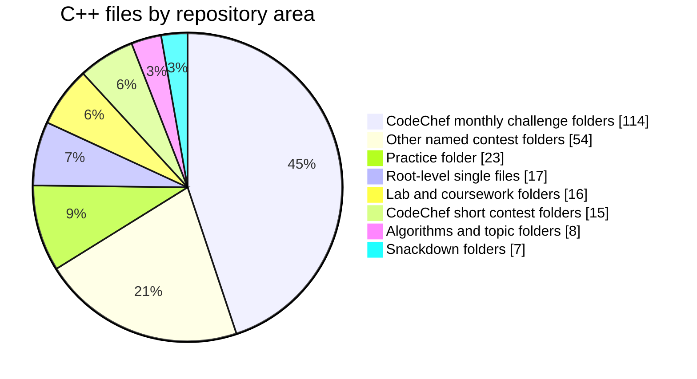

# Competitive Programming

A 2016 archive of C and C++ competitive programming solutions organised by contest, practice, algorithm, and coursework folders.

## What is inside

- 254 tracked C++ files and 6 tracked C files.
- Contest folders for CodeChef monthly challenges, Cook-Off, Lunch Time, Snackdown, ACM-ICPC, ZCO, SPOJ, HackerRank, LOC, and local contests.
- Practice and reference folders such as `Algorithms`, `BIG O`, `G4G`, `Practice`, and `Lab Work`.
- Supporting material includes text input/output files, PDFs, a shell script, and a spreadsheet.
- A small number of compiled `.exe` and `.o` artefacts are tracked alongside source files.

## Solution map

| Area | C++ files | Evidence in folder names |
| --- | ---: | --- |
| CodeChef monthly challenge folders | 114 | April, February, January, July, June, March, May, November, and October challenge folders |
| CodeChef short contest folders | 15 | Cook-Off and Lunch Time folders |
| Snackdown folders | 7 | `SNACK DOWN 16`, `Snackdown 2016` |
| Practice folder | 23 | `Practice` |
| Lab and coursework folders | 16 | `Lab Work`, `UNIX`, `SIMPLEX` |
| Algorithms and topic folders | 8 | `Algorithms`, `BIG O`, `G4G` |
| Other named contest folders | 54 | ACM-ICPC, Code Flux, Code Fusion, Code Wars, Codiyappa, Hackerrank, Knuth Cup, LOC, SOPC, SPOJ, ZCO |
| Root-level single files | 17 | Standalone `.cpp` files in the repository root |

## Reading the repository

- Folder names are the best guide to contest or topic context.
- Source files are the primary reusable material.
- Input, output, PDF, and spreadsheet files are supporting artefacts from the same snapshot.
